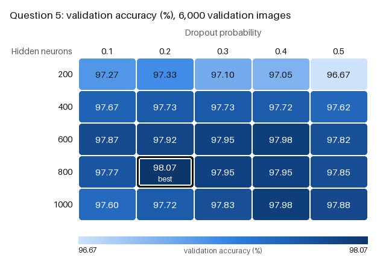

# Question 5: MLP hyperparameter search (hidden size × dropout)

The original single-hidden-layer MLP of Question 1 was extended with dropout between the hidden
layer (after the ReLU) and the output:

`Linear(784, h) → ReLU → Dropout(p) → Linear(h, 10) → log-softmax`

25 combinations were evaluated on a validation set: h ∈ {200, 400, 600, 800, 1000} ×
p ∈ {0.1, 0.2, 0.3, 0.4, 0.5}. The winning combination was then retrained from scratch on all
60,000 training images (3 GPU runs) and evaluated on the 10,000-image test set. This is not the
two-hidden-layer model of Question 4.

## Protocol

- **Training configuration (unchanged from the original MLP):** Adam, learning rate 0.001,
  batch size 100, 5 epochs, NLL loss on log-softmax outputs, `ToTensor()` input flattened to 784.
- **Split:** `torch.utils.data.random_split` of the 60,000 training images into 54,000 for
  training and 6,000 (10 %) for validation, with a fixed seed (0). The same split is used for all
  25 configurations. SHA-256 hashes of both index sets are recorded in `best_config.json`.
- **Search:** each configuration is trained on the 54,000 images and evaluated on the 6,000.
  All use the same seed (0) for weight initialisation and shuffle order, and the same warm-up
  and timing as Question 1. The validation images are never in the training loader, and the
  loader checks that evaluation covers exactly the validation indices.
- **Selection:** by validation accuracy only (number of correct validation images). Ties are
  broken by fewer hidden neurons, then by lower dropout. The test set is not loaded during the
  search. The winner is written to `best_config.json` before the test set is first used.
- **Final model:** the winner is trained from scratch on all 60,000 training images (the
  training and validation sets together, as the assignment requires) with seeds 0, 1, 2. It is
  evaluated on the 10,000 test images with the Question 1 protocol (warm-up, GPU-synchronized
  timing).

## Validation results (accuracy %, 6,000 validation images)



| Hidden \ Dropout | 0.1 | 0.2 | 0.3 | 0.4 | 0.5 | Row mean |
|---|---|---|---|---|---|---|
| 200 | 97.27 | 97.33 | 97.10 | 97.05 | 96.67 | 97.08 |
| 400 | 97.67 | 97.73 | 97.73 | 97.72 | 97.62 | 97.69 |
| 600 | 97.87 | 97.92 | 97.95 | 97.98 | 97.82 | 97.91 |
| 800 | 97.77 | **98.07** | 97.95 | 97.95 | 97.85 | 97.92 |
| 1000 | 97.60 | 97.72 | 97.83 | 97.98 | 97.88 | 97.80 |
| Column mean | 97.63 | 97.75 | 97.71 | 97.74 | 97.57 | |

**Winner: 800 hidden neurons, dropout 0.2.** It reaches 98.07 % validation accuracy (5,884 of
6,000) and has 636,010 parameters. The runner-ups are 600 / 0.4 and 1000 / 0.4, tied at 97.98 %
(5,879). No other configuration ties with the winner.

- **Width matters more than dropout.** The row means rise from 97.08 % (200) to 97.69 % (400) and
  about 97.9 % (600–800), with a slight drop at 1000. The column means differ by only 0.18
  percentage points (97.57–97.75 %).
- **The highest dropout (0.5) is the weakest column, especially for the narrowest network**
  (96.67 % at 200 neurons). With 200 units, dropping half of them leaves too little capacity.
- **The selection is close.** The winner leads the runner-up by 5 images (0.08 percentage points).
  One standard error of a validation accuracy near 98 % on 6,000 images is about 0.18 percentage
  points, and 17 of the 25 configurations lie within two standard errors of the best. The grid
  therefore identifies a broad good region (600–1000 neurons, dropout 0.2–0.4) rather than one
  clearly superior setting.

## Final model: 3 GPU runs on all 60,000 training images

| Run | Seed | Test accuracy | Training (s) | Inference (s) |
|---|---|---|---|---|
| 1 | 0 | 97.87 % | 9.20 | 0.253 |
| 2 | 1 | 98.13 % | 9.10 | 0.248 |
| 3 | 2 | 97.91 % | 9.36 | 0.263 |
| **Mean ± sample SD** | | **97.97 ± 0.14 %** | **9.22 ± 0.13** | **0.255 ± 0.008** |

## Comparison with Questions 1 and 4

| Model | Architecture | Parameters | Test accuracy | Training (s) | Inference (s) |
|---|---|---|---|---|---|
| Q1 original MLP | 784 → 100 → ReLU → 10 | 79,510 | 96.97 ± 0.06 % | 9.66 | 0.274 |
| **Q5 tuned MLP** | 784 → 800 → ReLU → Dropout(0.2) → 10 | 636,010 | **97.97 ± 0.14 %** | 9.22 | 0.255 |
| Q4 enhanced MLP | 784 → 500 → ReLU → Dropout(0.2) → 200 → ReLU → Dropout(0.2) → 10 | 494,710 | 98.04 ± 0.12 % | 10.48 | 0.275 |

| Q5 vs | Accuracy difference | Training time ratio | Inference time ratio |
|---|---|---|---|
| Q1 original MLP | **+1.00 percentage points** | 0.95 | 0.93 |
| Q4 enhanced MLP | −0.07 percentage points | 0.88 | 0.93 |

- **Compared with the original MLP**, the tuned single-hidden-layer MLP gains 1.00 percentage
  points: about 203 instead of 303 test errors per 10,000 images. Every tuned run (97.87–98.13 %)
  is above every Question 1 run (96.91–97.02 %).
- **Compared with the Question 4 two-hidden-layer MLP**, the difference (−0.07 percentage points)
  is smaller than the run-to-run standard deviations of both models (0.12–0.14). The two
  architectures perform practically the same. The tuned MLP gets there with one wider hidden
  layer, and Question 4 with two layers and fewer parameters. A formal test is left for
  Question 8.
- **Timing differences are small** (within ±12 %) and partly session-to-session variation. The
  tuned MLP being slightly *faster* than the Question 1 MLP despite 8 times more parameters
  confirms that CPU-side data loading dominates the measured time for these networks.

## Limitations

- **One seed per configuration during the search.** With 25 configurations and differences
  around one standard error, the winner is partly chance. Another split or seed could select a
  neighbouring configuration (e.g. 600 / 0.4). Repeating each configuration with several seeds
  would make the selection more robust, at a cost of ~3.5 minutes of training per extra seed.
- **The search optimises validation accuracy for 5 epochs.** With more epochs, the best dropout
  may be higher, because stronger regularisation usually needs longer training.
- **Final retraining uses 11 % more data** (60,000 vs 54,000 images) than the search, as the
  assignment requires. Validation and test accuracies are therefore not directly comparable.
- **3 final runs only;** the timing baselines come from earlier sessions on the same machine.

## Generated files

| Path | Content |
|---|---|
| `results/question5/validation_grid.csv` | all 25 configurations, ranked: hidden size, dropout, seed, train/validation sizes, correct, validation accuracy, training time, validation inference time, per-epoch loss |
| `results/question5/validation_grid.png` | 5×5 heatmap of validation accuracy, winner outlined |
| `results/question5/best_config.json` | winner, selection criterion, tie-break rule, runner-up, split method/seed/sizes and index hashes, time of selection |
| `results/question5/final_runs.csv` | the 3 final runs: seed, training images, correct, test accuracy, training/inference time, per-epoch time and loss |
| `results/question5/comparison.csv` | Q5 vs Q1 and Q4: per metric, baseline and Q5 mean ± SD, difference, ratio |
| `results/question5/summary.json` | architecture, hyperparameters, search grid, protocol, environment, aggregates, comparison, SHA-256 of the Q1/Q4 baseline files |
| `results/question5/predictions_final_run{1,2,3}_seed{0,1,2}.csv` | per-image test predictions with MNIST index (for Question 8) |
| `results/question5/logs/q5_run.log` | console log |

## Reproduce

```bash
source .venv/bin/activate
python q5_mlp_hyperparameter_search.py --overwrite     # ~5 min on the GPU (25 searches + 3 final runs)
python -m unittest discover -s tests -t . -v
```
