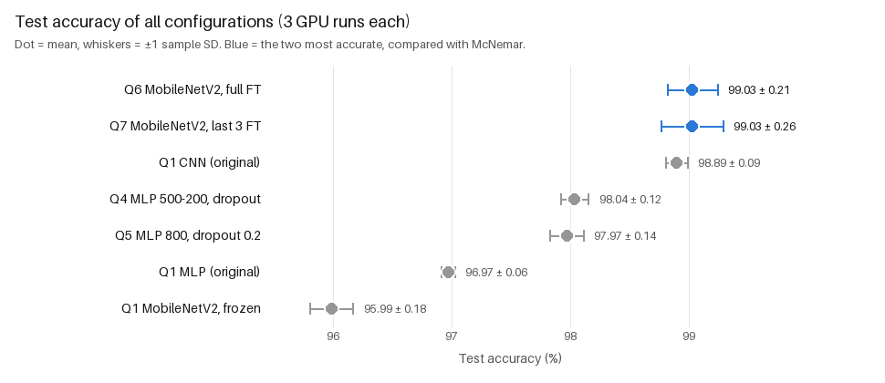
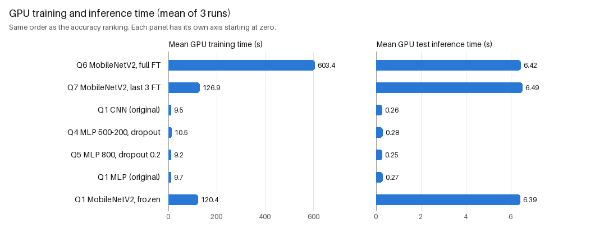

# Question 8: Final comparison and statistical analysis

This is the consolidated comparison of every experiment in Questions 1–7, built entirely from the
saved result files. **No model was trained and no inference was run.** Every accuracy below was
recounted from the saved per-image predictions, which cover the 10,000 MNIST test images with
labels matching the MNIST test set.

## Consolidated results (GPU, 3 runs per configuration, seeds 0, 1, 2)

Ranked by mean test accuracy. Ties are broken by fewer trainable parameters, then by the fixed
configuration order. Gap = difference from the highest mean, in percentage points.

| Rank | Configuration | Architecture / training | Accuracy (mean ± sample SD) | Gap | Training (s) | Inference (s) | Trainable parameters |
|---|---|---|---|---|---|---|---|
| 1 | Q6 MobileNetV2, full fine-tuning | ImageNet MobileNetV2, all layers trained | **99.03 ± 0.21 %** | — | 603.39 | 6.424 | 2,236,682 |
| 2 | Q7 MobileNetV2, last 3 layers fine-tuned | ImageNet MobileNetV2, `features[16..18]` + classifier trained | **99.03 ± 0.26 %** | −0.003 | 126.90 | 6.492 | 1,218,890 |
| 3 | Q1 CNN (original) | 2 conv (32, 64; 3×3) + max-pool + Linear 1600→10 | 98.89 ± 0.09 % | −0.14 | 9.54 | 0.257 | 34,826 |
| 4 | Q4 MLP 500-200, dropout 0.2 | 784-500-200-10, ReLU + Dropout(0.2) after each hidden layer | 98.04 ± 0.12 % | −0.99 | 10.48 | 0.275 | 494,710 |
| 5 | Q5 MLP 800, dropout 0.2 | 784-800-10, ReLU + Dropout(0.2), tuned on a validation set | 97.97 ± 0.14 % | −1.06 | 9.22 | 0.255 | 636,010 |
| 6 | Q1 MLP (original) | 784-100-10, ReLU | 96.97 ± 0.06 % | −2.06 | 9.66 | 0.274 | 79,510 |
| 7 | Q1 MobileNetV2, frozen features | ImageNet MobileNetV2, classifier trained only | 95.99 ± 0.18 % | −3.04 | 120.36 | 6.388 | 12,810 |

All configurations use Adam, learning rate 0.001, batch size 100 and NLL/cross-entropy loss. MLPs
and the CNN train for 5 epochs, the MobileNetV2 variants for 3. All train on the 60,000 training
images, except that Question 5 selected its hyperparameters on a 54,000/6,000 split. Training time
= all epochs, including data loading; inference = one pass over the 10,000 test images. Mean
errors per 10,000 test images: 97.0, 97.3, 110.7, 196.3, 203.0, 303.0, 401.3 (ranks 1–7). The
three MobileNetV2 variants have 2,236,682 parameters in total; the trainable count differs.





## Main findings

- **Highest observed mean accuracy:** Q6 (99.030 %), followed by Q7 (99.027 %). They are one
  correct test image apart over three runs (29,709 vs 29,708 of 30,000), so the ranking order of
  these two is not meaningful. The McNemar test below finds no significant difference. The next
  model, the original CNN, is 0.14 percentage points lower.
- **Fastest GPU training:** the Q5 MLP (9.22 s), but every MLP and the CNN lie between 9.22 and
  10.48 s. These differences are within the run-to-run and session-to-session variation (SD up to
  0.48 s), because CPU-side data loading dominates the training time of these small networks
  (Question 1). By network type: MLPs and the CNN train in about 10 s, MobileNetV2 in 120–603 s.
- **Fastest GPU inference:** again the Q5 MLP (0.255 s), practically tied with the CNN (0.257 s)
  and the other MLPs (0.274–0.275 s). The MobileNetV2 variants need about 6.4–6.5 s, about 25 times
  longer, because each image is resized to 224×224 and passed through a much deeper network.
- **Best accuracy / training-time trade-off:** the configurations that no other configuration
  beats on both accuracy and training time (the Pareto front) are Q5 MLP → Q1 CNN → Q7 → Q6, in
  order of training time. The **original CNN** is the best trade-off: it is 0.14 percentage points
  below the best MobileNetV2 result, while training 13 times faster than Q7 (63 times faster than
  Q6), with 25 times faster inference and 35,000 instead of 1.2–2.2 million trainable parameters.
- **Recommended choice:**
  - If the highest accuracy is the goal, **MobileNetV2 with only the last 3 layers fine-tuned
    (Q7)** is the preferable specification. Its observed accuracy is nearly identical to full
    fine-tuning (no significant difference), while it trains 4.8 times faster and uses 1.05 instead
    of 7.39 GiB of GPU memory.
  - If training/inference cost or deployment size matter, the **original CNN** gives almost the
    same accuracy at a small fraction of the cost.
  - The MLPs are clearly less accurate (best 98.04 %). The frozen MobileNetV2 is the least
    accurate configuration: fixed ImageNet features are not enough.

## Statistical significance: best vs second best

**Rule, fixed before computing the test:**
- Compare the two configurations with the highest mean accuracy, Q6 (A) and Q7 (B).
- Use one run each, **seed 0** (run 1 of both), the same rule for every configuration.
- Pair the predictions by original MNIST test index; the true labels were verified identical.
- Use the exact two-sided McNemar test, significance level **α = 0.05**.
- Report seeds 1 and 2 separately as a sensitivity check; runs are **not pooled**.

| Seed-0 runs (n = 10,000 test images) | Q7 correct | Q7 wrong |
|---|---|---|
| **Q6 correct** | 9,792 (both correct) | **89** (only Q6 correct) |
| **Q6 wrong** | **82** (only Q7 correct) | 37 (both wrong) |

- Accuracy on these runs: Q6 98.81 %, Q7 98.74 %.
- Discordant pairs: 89 + 82 = 171.
- **Exact two-sided p = 0.6465 > α = 0.05**, so the difference is **not statistically
  significant**.

Sensitivity check (each seed tested on its own, not combined):

| Seed | Only Q6 correct | Only Q7 correct | Exact p |
|---|---|---|---|
| 0 (primary) | 89 | 82 | 0.6465 |
| 1 | 55 | 41 | 0.1843 |
| 2 | 43 | 63 | 0.0645 |

None is significant at α = 0.05, and the direction changes between seeds (Q6 better for seeds 0
and 1, Q7 for seed 2).

**What the test shows, and what it does not:**
- The McNemar test uses only the images on which the two models disagree. Under the null
  hypothesis, each of the 171 disagreements is equally likely to favour either model. A p-value of
  0.65 means that a split of 89 vs 82 is entirely consistent with chance.
- The test therefore finds **no evidence** that the two trained models differ in error rate on the
  MNIST test set. It does **not** show that they are equivalent: a non-significant result is not
  proof of equality, and small real differences could go undetected.
- The test compares two specific trained models (one seed each). It does not by itself describe
  the variability over all possible training runs. The 3 seeds are not independent test sets: all
  use the same 10,000 images, so their 30,000 predictions are not pooled.

## How useful is the GPU? (Question 2, measured)

Each original network was trained and tested once on the CPU (AMD Ryzen 9 7900X, 12 threads) and
compared with its Question 1 GPU mean (AMD Radeon RX 9070 XT). Speedup = CPU time / GPU time.

| Network | CPU training (s) | GPU training (s) | Training speedup | CPU inference (s) | GPU inference (s) | Inference speedup |
|---|---|---|---|---|---|---|
| MLP | 8.58 | 9.66 | 0.89× (CPU faster) | 0.243 | 0.274 | 0.89× |
| CNN | 32.59 | 9.54 | 3.42× | 0.424 | 0.257 | 1.65× |
| MobileNetV2 (frozen) | 2,745.10 | 120.36 | 22.81× | 143.71 | 6.388 | 22.50× |

- **MLP: no benefit.** The network is too small; GPU transfer and launch overheads outweigh the
  computation, and CPU-side data loading dominates both runs.
- **CNN: moderate benefit** (3.4× in training). The convolutions are enough work for the GPU, but
  the shared CPU-side data loading limits the speedup.
- **MobileNetV2: the GPU is essential** (~23×): about 46 minutes of CPU training against 2 minutes
  on the GPU, even with frozen features.
- **Not measured:** the fine-tuned MobileNetV2 variants (Q6/Q7) were not run on the CPU. Q6 is
  limited by GPU computation (about 200 s per epoch, against about 40 s for the frozen model), so
  its CPU training would be expected to take far longer. This is not quantified here.
- **These speedups are lower bounds on the GPU's compute advantage,** because CPU-side image
  loading (`num_workers=0`, as in the original scripts) is included in every timing.

## Validation

- **Runs:** all seven configurations have exactly 3 saved GPU runs (seeds 0, 1, 2). Every
  prediction file has 10,000 unique original MNIST test indices (0–9999), and its true labels
  equal the MNIST test labels.
- **Accuracy:** every saved accuracy and correct count matches a recount from its prediction
  file. The comparison table was recomputed from the source `runs.csv` files.
- **McNemar:** the tables and exact p-values for all three seeds were recomputed independently
  with exact fraction arithmetic.
- **Question 5 leakage check (re-checked from its saved files):**
  - 25 configurations, each with 54,000 training and 6,000 validation images
  - no test-set columns in the search grid
  - the winner is the validation-accuracy maximum
  - the selection is logged before the final test phase
- **Integrity:** all 39 input files are unchanged (SHA-256 in `config.json`, identical to
  `master`). The three original scripts are byte-identical.
- **No new runs:** rerunning this analysis with the GPU hidden and no network access gives
  byte-identical outputs; it only reads files.

## Limitations

- **Only 3 runs per configuration**, so the standard deviations are rough. Differences of about
  0.1 percentage points (Q6/Q7/CNN, Q4/Q5) are of the order of the run-to-run variation.
- **Significance was tested only for the top two configurations,** on one primary seed as
  pre-specified. No correction for multiple comparisons is needed for that single test; the other
  seeds are a sensitivity check, not additional evidence.
- **Different measurement sessions:**
  - Q1 GPU runs: 2026-11-04, 20:31–20:38
  - Q2 CPU runs: 2026-11-04, 21:06–21:56
  - Q4 and Q5: 2026-11-04, later that evening
  - Q6 and Q7: 2026-11-05

  All ran on the same machine. Timing differences of a few percent between questions are within
  session variation.
- **Configurations differ in more than one factor** (architecture, number of epochs, input
  resolution, pretrained or not, dropout), so the table compares complete specifications, not
  single factors.
- **Training configuration:** all results use the assignment's configuration (learning rate
  0.001, 3 or 5 epochs). Other settings could change the ranking, especially among the close
  top three.

## Generated files

| Path | Content |
|---|---|
| `results/question8/model_comparison.csv` | all seven configurations, ranked: description, accuracy mean/SD/min/max, mean errors, gap to best, training and inference mean/SD, trainable/total parameters, Pareto flag, measurement time |
| `results/question8/statistical_test.json` | selection rule, the two models, primary seed-0 McNemar result (contingency table, discordant counts, exact p, α, decision), seed-1/2 sensitivity results, interpretation note |
| `results/question8/summary.json` | ranking, best/fastest configurations, Pareto front, primary p-value, Question 2 GPU/CPU figures, Question 5 leakage check |
| `results/question8/config.json` | ranking, Pareto and test-selection rules, α, configuration list, SHA-256 of all 39 input files |
| `results/question8/figures/accuracy_comparison.png` | mean accuracy ± SD for all configurations (dot plot) |
| `results/question8/figures/timing_comparison.png` | mean GPU training and inference time (two panels, each with its own axis) |

## Reproduce

```bash
source .venv/bin/activate
python q8_final_comparison.py --overwrite      # a few seconds; reads saved results only
python -m unittest discover -s tests -t . -v
```
